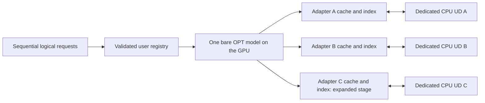

# R5-I4A sequential multi-user and multi-adapter integration

I4A adds functional sequential multi-adapter serving separately from I3F.
The latest I3F tracer, tests and numerical limitations were reviewed before
implementation. The two-adapter pilot was implemented and passed 14 CPU unit
tests plus actual ES/UD TCP generation and independent audit before adding C
and the 30-user workload. No existing implementation, I3F capture code, frozen
R3/R4 source, numerical threshold or previous result artifact is edited.

## Research handoff and claim boundaries

The latest user-verified RTX 3090 I3F handoff supersedes the earlier local-only
status for planning this new stage: GPU forensics, independent audit, physical
cache integrity, and controlled generated-token/text fidelity passed. Source,
constructed and consumed KV were bitwise identical in inspected comparisons.
The first observed divergence was identified. **Frozen numerical tolerance still
fails for R5_03 and R5_08; ROOT_CAUSE_UNRESOLVED.** I3F-B is explicitly deferred
to Future Work and is not investigated here.

Each new run preserves that handoff verbatim in `multi_historical.json` with
provenance `USER_VERIFIED_R5_I3F_GPU_HANDOFF`. It is not presented as locally
reanalyzed GPU evidence. Prior I3P/I3F files and their classifications remain
unchanged. Native PEFT strict parity and correctness-qualified E2E speedup remain
unestablished. Functional I4A gates are independent of matched numerical gates.
No current fixture PASS can erase a historical GPU failure or establish new GPU
execution. Even a passing current tolerance flag does not qualify performance.

## Architecture and contracts

There is one ES process and one immutable bare OPT-2.7B model per condition.
Multiple driver objects share that same model and adapter inspector; no additional
base model is loaded for another adapter. Each adapter has its own persistent,
CPU-only UD process, random session ID, channel matrix fingerprint, prefix grants,
request history, semantic index and physical Raw-QKV owner. The workload is
globally sequential. No adapter switching is implemented.



Two conditions run in separate ES processes with fresh state:
`DISTRIBUTED_NO_REUSE`, then `INTEGRATED`. They use the same prepared matrices,
base weights, tokenizer, user mapping, text, IDs and fixed greedy policy. Each
condition has new UD PIDs/sessions and empty caches, indices, clusterers and
prefix grants. The model is reloaded between conditions; only one base model
is resident at a time. The two-condition order is not a balanced performance
experiment and supplies no statistical speedup claim.

The new preparation schemas are `R5_MULTI_PREPARED_V1`, `R5_MULTI_ADAPTER_V1`
and `R5_MULTI_REGISTRY_V1`. Legacy R3/R4 validators remain restricted to their
original `user_a` artifacts. New adapters are not passed off as renamed legacy
preparations. A tagged `R5_MULTI_VALIDATED_RUNTIME_VIEW_V1` supplies independently
validated adapter identity to shared math/storage primitives; it is never written
as, or validated as, an R3-A prepared artifact.

The unchanged offline R3-A preparation supplies the verified base/tokenizer/GPU
anchor. Its legacy `user_a` matrices are not used for I4A generation. I4A prepares
new, genuinely different matrix bytes for A/B/C and validates each complete set
under its new contract. The ES holds no new LoRA tensors on the GPU; the selected
UD loads and applies its actual CPU matrices using unchanged `cpu_deltas`.

Each adapter manifest records ID, rank, alpha, scaling, all layer/role coverage,
dtype, A/B shapes/offsets, per-matrix digests, complete matrix fingerprint, seed,
preparation method, base/model fingerprint and revision, tokenizer fingerprint,
and fixture/physical-execution scope. Matrices are finite and nonzero, cover
every Q/K/V projection and are pairwise non-identical, including against the
legacy blob. Corrupt manifests, wrong blobs, unsupported scale/rank/dtype or
incompatible base/tokenizer are rejected before inference.

| Adapter | Source seed | Rank / alpha / scaling | Classification |
|---|---:|---|---|
| Adapter_A | 104729 | 8 / 8 / 1.0 | Controlled synthetic, untrained research adapter |
| Adapter_B | 130363 | 8 / 8 / 1.0 | Controlled synthetic, untrained research adapter |
| Adapter_C | 155921 | 8 / 8 / 1.0 | Controlled synthetic, untrained research adapter |

Preparation uses deterministic MT19937 uniform values in [-0.05, 0.05],
serialized as float32. A is `[8, hidden]` and B `[hidden, 8]` at all 32 layers
and all three roles. These are not trained personalized LoRA adapters. Real
OPT-width matrix fingerprints are generated and independently checked on SERAPH;
the scalar fixture's width-4 fingerprints are not those GPU-run fingerprints.

## Registry, authorization and cache namespaces

Pilot mapping is User_01/User_02 → A and User_03/User_04 → B. Expanded mapping
is User_01–User_10 → A, User_11–User_20 → B, User_21–User_30 → C. The registry
explicitly authorizes sharing within each adapter's group. No logical user
represents an inferred physical device. There are two or three physical UD
processes per condition, and four or six across both conditions.

A client-supplied adapter name cannot override the trusted registry. Unknown
users, mismatched mappings, unprepared adapters, changed requests or physical
namespaces fail before that request's model/LoRA work. Cross-user sharing also
requires matching groups and both members' permission; sharing across adapters
is forbidden even if groups or tokens match.

Each physical namespace binds the model and tokenizer revisions/fingerprints,
adapter ID and complete matrix fingerprint, rank, scaling, matrix dtype/layout,
registry seal, sharing policy, eager OPT implementation/cache API contract,
execution source hashes, device/GPU UUID, exact token positions and masks, and
unchanged Raw-QKV format. Each cache has a separate bounded byte allocation.
The existing token-derived two-source capacity and LRU policy are retained;
there is no shared global eviction policy. Global occupancy/peak are independently
replayed over chronological adapter events, rather than attributing model memory
to each adapter or summing noncoincident cache peaks.

The physical owner rechecks source/target authorization before accessing owned
tensors. Actual cache decisions still arise from TinyBERT → unchanged clusterer
→ token-window discovery → exact-prefix/physical/permission eligibility → owned
Raw-QKV validation → reconstructed past → suffix-only forward. Expected workload
outcomes are asserted only after execution, never supplied to the dispatcher.
Cached Q is stored/sealed/accounted but is not consumed for prefix reuse.

Private indices do not return foreign candidates to logical clients. A privileged
operator-only isolation probe checks actual matching foreign metadata, rejects
it before any foreign tensor lookup, and records aggregate reasons/counts.
The independent auditor reconstructs those counts from its private event replay.
Logical client results contain only their request ID, completion, generated IDs,
text and termination, with no source/candidate/cache metadata. Output directories
are mode 0700 and CLI writes use umask 0077. This is a controlled logical-user
research runner, not a deployed authentication or concurrent serving service.

## CPU UD and production inference

`R5_MULTI_ADAPTER_TCP_V1` wraps the unchanged bounded TCP framing and C1 context.
Handshake binds adapter/matrix/registry/physical/cohort identity. Every actual
HIDDEN frame carries its sealed authorized request. The dedicated UD verifies
mapping, context, source/target sharing and immutable request identity before
applying its matrices. DELTAS receipts bind that route, adapter, matrix fingerprint,
user, independent PID, hidden payload and C1 context.

The frozen `ProjectionSession`, `QualityDriver.c_forward`, `physical_path`,
CPU LoRA arithmetic, raw-to-attention conversion and `r5_generation.generate`
remain the inference path. No GPU LoRA module, hidden prefix recomputation,
teacher forcing or cache transformation is introduced. UD state starts empty,
completion/register/evict controls are replayed, all valid requests finish, and
all UD processes shut down successfully. No old session is switched to another
adapter. Unsupported/corrupted conditions fail closed; the separate no-reuse
condition remains available for reference without consuming cached KV.

## Workload and metrics

The pilot executes A source P → A cross-user suffix target → B source P → B
cross-user suffix target, with four users and complete generation. B's first
P cannot consume A's entry; B subsequently creates and reuses its own source.
Mapping rejection controls are labeled nongenerated probes and send no frames.

The expanded stage interleaves each of the original ten R5 controlled texts
across A/B/C. Each adapter has ten different logical users and the same causal
P/Q/R lifecycle: admission, cross-user reuse, capacity eviction, post-eviction
full recomputation, a semantic candidate rejected by exact physical eligibility,
re-admission and further reuse. Actual OPT tokenization must satisfy the original
prefix boundaries. The independent auditor requires the observed lifecycle and
token-derived capacity. It never dispatches from an expected HIT label.

Pilot has four requests per condition; expanded has thirty per condition.
Generation is fixed greedy G2–G8, with G4 in both prepared jobs. Physical HIT rate
is a measurement of this controlled workload, not natural-dataset traffic or
real-user scalability. The first CPU runs observed 2/4 pilot HITs and 12/30
expanded HITs, 12 expanded admissions, three evictions and 87 rejected foreign
candidates. Final verification is recorded separately below.

`multi_metrics.json` separates per-condition global and per-adapter metrics:
logical users, actual UD processes, requests, summed semantic candidates,
HIT/MISS, rejected foreign candidates, reused tokens, admissions/evictions,
occupancy/peak/capacity, hidden/delta and prefill/Decode payload, directional wire,
actual CPU LoRA time, encoding/cluster/candidate/eligibility/lookup times,
model/application TTFT and E2E, token fidelity, tolerance results, and GPU memory
observations. GPU memory samples describe the shared ES and are not per-adapter
base-model allocations. CPU LoRA time is measured around arithmetic separately
from the retained deserialize/arithmetic/serialization exchange span. Timings
are instrumented descriptive results; nested intervals are not additive.

## Independent evidence and audit

Runs are fresh immutable outputs under `results/r5/multiuser/`. Existing I3P/I3F
outputs are never overwritten. Each condition reuses the cross-process I3P
Writer quota, exclusive blobs, periodic/final reconciliation, pipe accounting
and independent read-only inventory audit. Default cap is 4 GiB per condition,
plus a checked 1 GiB setup/report allowance. The final parent manifest hashes
all contained evidence and ledgers. Incomplete workers, source changes, budget
failures, wrong identities, corrupt files, stale grants and late report failures
cannot retain passing gates.

| Artifact | Evidence |
|---|---|
| `multi_prepare/` or operator `adapters/` | Versioned complete adapter manifests/blobs, registry, base/tokenizer binding, immutable inventory |
| `multi_config.json`, `multi_sources.json`, `multi_historical.json` | Exact settings/source hashes and unchanged numerical handoff |
| `<condition>/registry.json`, `workload.json`, `requests.jsonl` | Authorized assignments, actual tokenization and global sequential order |
| `<condition>/<adapter>/identity.json`, `initial.json`, `final.json` | Runtime fingerprint, empty startup state and isolated ownership snapshots |
| `<condition>/<adapter>/ud/` | Independent PID/session, actual matrix identity, CPU isolation, layer/controls/wire logs and lifecycle |
| `<condition>/<adapter>/es/` | Production forward/token traces, strict raw/prefill tensors, logits and independent wire records |
| `<condition>/events.jsonl`, `ownership.jsonl`, `isolation.jsonl` | Semantic transitions, ACL-bound completed-source ownership, physical capacity/LRU and rejected foreign candidates |
| `<condition>/generation.jsonl`, `client_results/` | Actual generation versus deliberately minimal logical-client outputs |
| `multi_audit.json`, `multi_adapter_validation.json` | Independent protocol/identity/physical/semantic replay and matrix verification |
| `multi_fidelity.json`, `multi_metrics.json`, `multi_decision.json` | Matched outputs, measured metrics and separate gates |
| `r5_output_manifest.json` | Complete content-hash inventory |

The auditor validates the prepared bytes and registry, physical contract, fresh
actors, global chronology, both TCP endpoint records, route-to-matrix receipts,
source completion, all actual QKV/attention layouts and positions, byte-derived
source/suffix/Decode KV, cached-prefix preservation, index/cluster transitions,
permission/longest-prefix dispatch, LRU release/invalidation and every occupancy
counter. It checks greedy selection and complete generated histories against
actual logits and C1 completion receipts. Source, constructed and consumed KV
integrity is independent of full-target numerical agreement.

Every request has a matched same-adapter no-reuse reference. The unchanged R3-A
allclose/max_abs/relative-L2/KL/argmax thresholds are calculated for each aligned
generation step. Comparisons stop when prior histories differ; skipped histories
cannot pass the complete tolerance gate. Token/text equality and logit bitwise
equality are separate outcomes. Functional completion/audit gates can pass when
numerical tolerance fails. The historical I3F failures remain explicit regardless
of current results; there is no numerical causality experiment or correction.

## CPU verification and local operation

The host has no Torch, NumPy, Transformers or PEFT. CPU fixtures use the existing
32-layer scalar decoder and real independent-process localhost TCP, with actual
different matrix values and physical cache owners. They do not qualify real OPT,
FP16 GPU inference or performance. New tests cover preparation/fingerprints,
incorrect loading and corrupt manifests, registry/ACL misuse, automatic shared
HITs, foreign-owner rejection, session isolation, eviction/index invalidation,
generation, numerical failure reporting, redacted client results and independent
reports. Forged identity/session/ownership tests update accounting consistently
before requiring the semantic/physical audit to reject the evidence.

```bash
python3 scripts/116_run_r5_multiuser.py --phase dry-run --stage expanded \
  --output-dir results/r5/multiuser/my_unique_dry_run
python3 scripts/116_run_r5_multiuser.py --phase fixture --test-fixture-only \
  --stage pilot --generation-budget 2 --condition-budget-bytes 536870912 \
  --output-dir results/r5/multiuser/my_unique_pilot
python3 scripts/116_run_r5_multiuser.py --phase fixture --test-fixture-only \
  --stage expanded --generation-budget 2 --condition-budget-bytes 536870912 \
  --output-dir results/r5/multiuser/my_unique_expanded
python3 scripts/117_analyze_r5_multiuser.py \
  --inputs results/r5/multiuser/my_unique_expanded \
  --output-dir results/r5/multiuser/my_unique_independent_analysis
PYTHONPATH=src:tests python3 -m unittest tests.test_r5_multi \
  tests.test_r5_multi_processes -v
```

Final local validation belongs to `results/r5/multiuser/local_verification_20261101/`.
Its full test log includes I4A, I3P/I3F and unchanged R4 cache/session/metric/API
regressions. Earlier exploratory pilot/expanded evidence is retained separately;
the original pilot completion predates implementation of the expanded stage.

Final verification covers **154 unique test cases: 151 passed and three optional
dependency checks skipped**, with no unresolved test failures:

| Suite | Final result |
|---|---|
| I4A | 31 passed: 19 unit tests and 12 process/launcher tests |
| Existing R5-I3P/I3F and integration | All 92 passed across the recorded runs |
| Unchanged relevant R4 | 28 passed, three dependency skips |

The initial aggregate executed 147 tests with one setup error and three skips.
I mistakenly placed the I3F fixture under the I4A results namespace; the unchanged
forensic runner correctly rejected that location before inference. That failure
remains in `cpu_tests.log`. The affected unchanged nine-test process suite then
passed at `results/r5/fidelity/i4a_regression_20261101/`, recorded in
`i3f_process_retry.log`. After final adapter-role validation was tightened, the
complete I4A suite passed again with fresh pilot/expanded evidence in
`final_integration/`, recorded in `i4a_final_tests.log`. These are explicit
targeted reruns, not a relabeling of the failed aggregate as PASS.

The three R4 skips are the two installed-HF/OPT API checks (Torch/Transformers/
NumPy absent) and official ROUGE-package check. No skipped check is counted as
passing. Intentional negative launcher tests also print FAILED JSON records
while their unittests pass; these are separate from the setup error above.

| Integrated CPU fixture | Pilot | Expanded |
|---|---:|---:|
| Logical users | 4 | 30 |
| UD processes per condition | 2 | 3 |
| Requests per condition | 4 | 30 |
| Physical HIT / MISS | 2 / 2 | 12 / 18 |
| Controlled-workload HIT rate | 50% | 40% |
| Rejected foreign candidates | 2 | 87 |
| Admissions / evictions | 2 / 0 | 12 / 3 |
| Reused prefix tokens | 20 | 117 |
| Final cache occupancy bytes | 30,720 | 87,552 |
| Peak aggregate cache bytes | 30,720 | 92,160 |
| Token/text fidelity | PASS | PASS |
| Frozen numerical tolerance | PASS, CPU only | PASS, CPU only |
| Independent audit | PASS, CPU only | PASS, CPU only |

Both conditions together complete eight pilot and sixty expanded requests.
Expanded has ten logical users, four HITs, four admissions and one eviction per
adapter. Post-eviction misses and index invalidations are independently verified.
Actual first-layer CPU correction payloads differ across adapters for identical
first-layer inputs, and each adapter's payload agrees across conditions.

The following complete blob hashes belong specifically to the width-4 scalar
CPU fixtures. The real OPT-width preparations will produce their own hashes:

| Adapter | CPU fixture matrix SHA-256 |
|---|---|
| Adapter_A | `4010354406978e9020b409da8fc07fd5acc2fddfd92522d2138d60c8417cba94` |
| Adapter_B | `f95a79b2f8648d5fc4cb44089a86b59b7ac02ae48955587127bf914034a65103` |
| Adapter_C | `6835ee418bf09dbbc356ac094cc5a2e9bf5b36f43b7f1e7df671ce45dfa4d1af` |

All nine requested I4A gates are recorded per experiment. Preparation, adapter
identity, same-adapter cross-user HIT, cross-adapter isolation, UD isolation,
generation and independent audit pass in both CPU fixtures. The current frozen
numerical gate passes in the CPU fixtures; **R5_I4A_GPU_EXECUTION_PASS is false /
NOT_RUN**. Every functional PASS is CPU-scoped. The historical GPU tolerance
FAIL, unresolved cause, Native PEFT parity and speedup limitations remain in
every final report. `verification.json` records the exact split test coverage,
artifact hashes, gate scopes and source preservation; each run/analysis and the
final validation directory have immutable content-hash manifests.

## Separate operator-controlled RTX 3090 jobs

No GPU experiments or Slurm jobs are executed by this task. Commit all new
execution sources on `exp/raw-semcache-r5-integration` before submission. The
jobs refuse dirty tracked source, untracked execution paths, mismatched HEAD,
missing explicit opt-ins, wrong GPU allocation, insufficient resources or missing
offline dependencies. They use SERAPH's established `batch_eebme_ugrad` /
`moana-y4` allocation: one RTX 3090, four CPUs, 64 GiB and three hours.

Preflight requires over 10 GiB free disk for the worst-case bounded evidence,
one RTX 3090 with over 8 GiB available before model load, four allocated CPU
cores, offline OPT/tokenizer and TinyBERT revision
`34707a33cd59a94ecde241ac209bf35103691b43`. The serving portion has a configurable
60–7200-second total runtime cap, leaving allocation time for preparation/audit.
Runtime expiry fails closed and preserves partial evidence. No download is
attempted. Fresh R3-A base preparation binds the allocated GPU UUID; fresh I4A
preparation creates two or three actual new matrix sets. Each job writes a new
stage/job/timestamp directory and preserves launcher failure stage.

Pilot (two adapters / four logical users):

```bash
cd /data/khuss/repos/GP_semcache
mkdir -p logs
R5_ENABLE_GPU=1 R5M_ENABLE_GPU=1 \
  R5M_SOURCE_COMMIT=$(git rev-parse HEAD) \
  sbatch jobs/r5_multiuser_pilot.sh
```

Expanded sequential evaluation (three adapters / thirty logical users), after
reviewing the GPU pilot's functional/isolation/audit results:

```bash
cd /data/khuss/repos/GP_semcache
mkdir -p logs
R5_ENABLE_GPU=1 R5M_ENABLE_GPU=1 \
  R5M_SOURCE_COMMIT=$(git rev-parse HEAD) \
  sbatch jobs/r5_multiuser_expanded.sh
```

Both jobs run G4 with 4 GiB per condition and invoke independent analysis into a
new directory. To analyze transferred data, include the recorded small base
prepared artifacts and I4A adapter directory and preserve/mount their recorded
paths. The auditor loads no OPT checkpoint and launches no GPU inference.

## I4B handoff

I4B clustering/cache-policy comparisons are not implemented. They can build on
this versioned preparation, registry, private ownership, session and audit layer
after the real I4A GPU pilot and expanded functional/isolation gates are reviewed.
Known strict numerical failures remain labeled and do not become a claim of
qualified speedup. I3F-B is not a prerequisite imposed by this implementation.
Concurrent serving, policy optimization, compression, cross-adapter transforms,
Qwen migration and full-dataset benchmarks remain separate later work.

## Created files

`src/semcache/edgelora/r5_multi_artifacts.py`, `r5_multi_controller.py`,
`r5_multi_session.py`, `r5_multi_runtime.py`, `r5_multi_analysis.py`;
`scripts/116_run_r5_multiuser.py`, `scripts/117_analyze_r5_multiuser.py`;
`jobs/r5_multiuser_pilot.sh`, `jobs/r5_multiuser_expanded.sh`;
`tests/test_r5_multi.py`, `tests/test_r5_multi_processes.py`; and this document.
All pre-existing source and forensic behavior remain unchanged.
